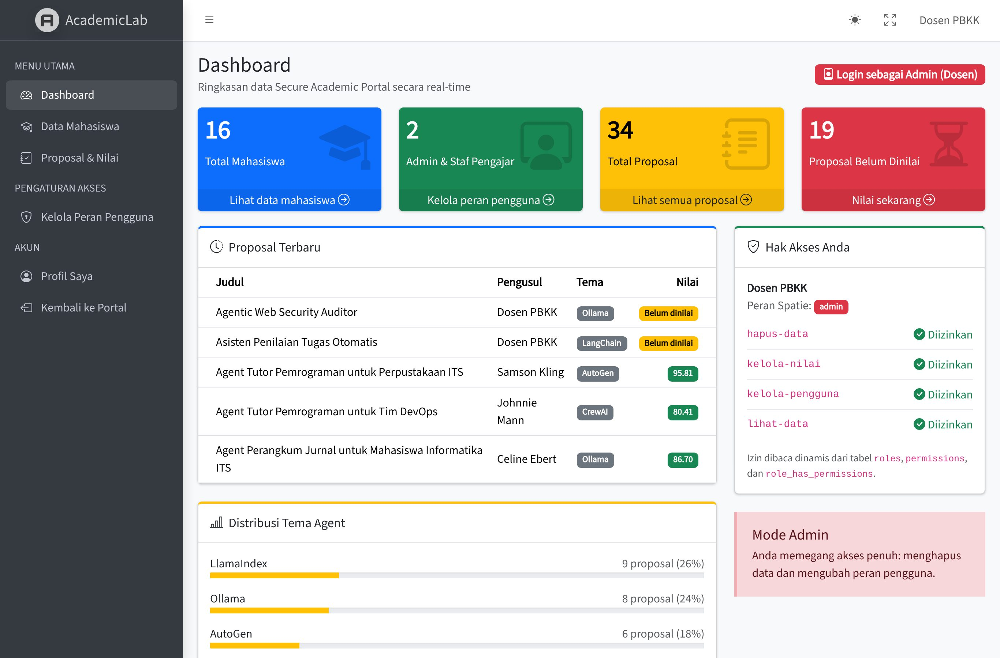
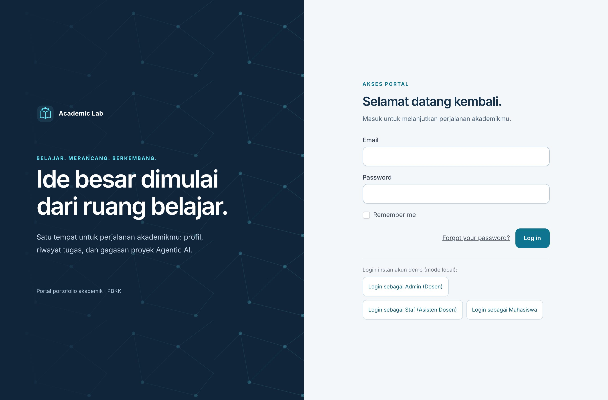
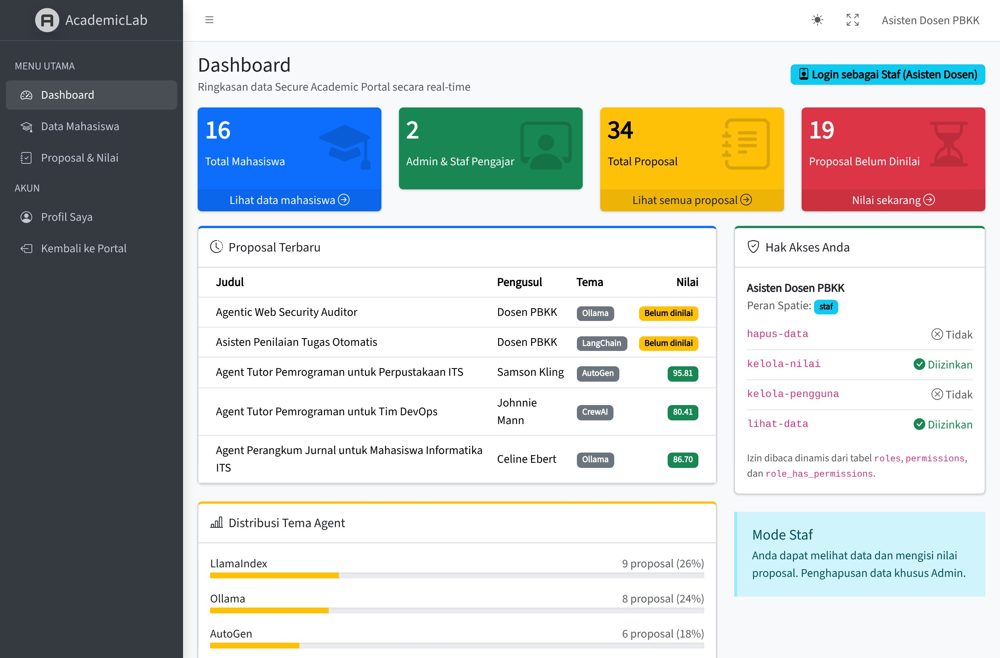
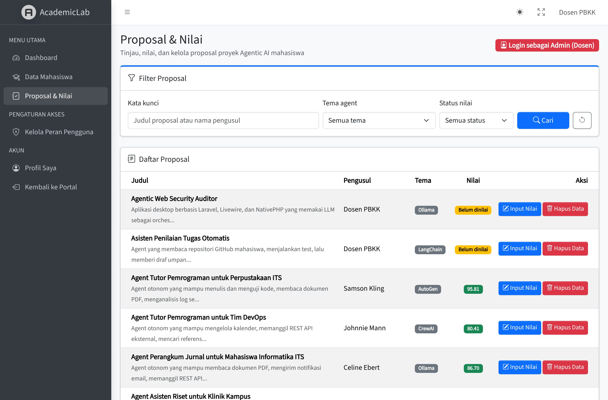
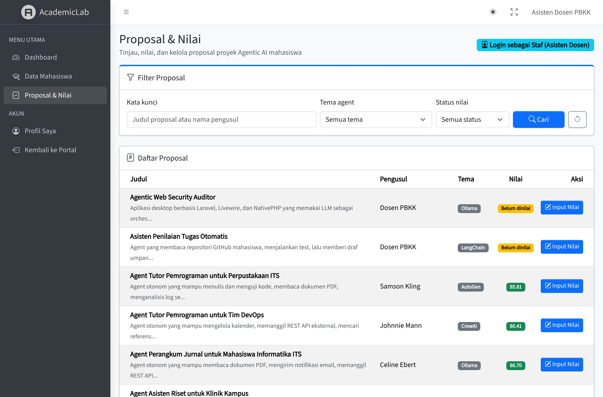
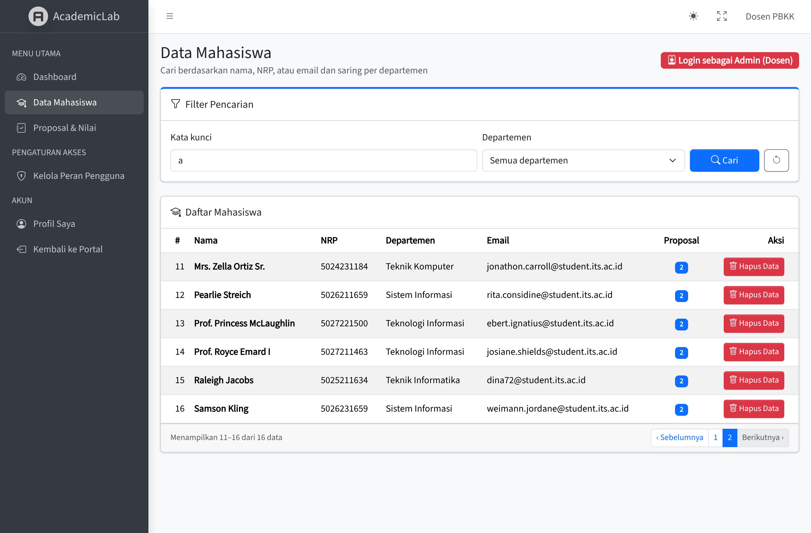
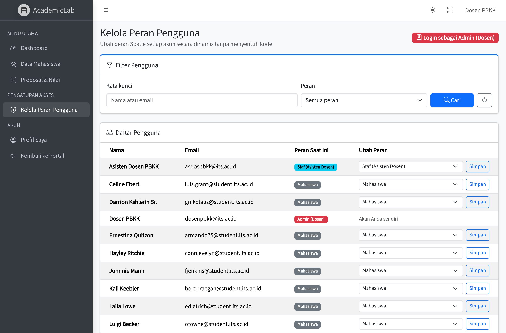

# Secure Academic Portal — Tugas PBKK Pertemuan 5, 6 & 10

Pengembangan dari `tugas1_5025241151_AdrianAfzalZaidana` (Laravel 13) menjadi portal akademik dengan
autentikasi **Laravel Breeze**, basis data proposal proyek Agentic AI, dan (Pertemuan 10) **panel admin
AdminLTE** dengan **Role-Based Access Control Spatie Laravel Permission**: peran `admin` (akses penuh),
`staf` (akses terbatas), dan `mahasiswa`.



## Cara Menjalankan

Panduan berikut dapat digunakan untuk menyiapkan dan menjalankan aplikasi di komputer masing-masing. Semua perintah terminal dijalankan dari folder `secure-academic-portal`, yaitu folder yang berisi file `artisan` dan `composer.json`.

### Persiapan

Siapkan **PHP 8.4** (file `composer.lock` memuat paket pengembangan yang mensyaratkan PHP 8.4.1 atau lebih baru), **Composer**, **Node.js 20.19+ pada versi 20 atau 22.12+**, dan **MySQL**. Pastikan perintah `php`, `composer`, `node`, dan `npm` tersedia di terminal, serta ekstensi PHP `pdo_mysql` aktif.

Database aplikasi memakai MySQL sesuai tugas pertemuan 6. SQLite hanya digunakan untuk pengujian otomatis secara default.

### Setup awal (cukup sekali)

1. Unduh atau clone repositori, lalu buka folder **`secure-academic-portal`** di VS Code melalui **File → Open Folder**. Buka terminal melalui **Terminal → New Terminal** atau tekan **Ctrl + `**. Pada Windows, gunakan **PowerShell**.

2. Instal dependensi, bangun aset tampilan, lalu publikasikan aset AdminLTE ke `public/vendor`:

   ```powershell
   composer install
   npm install
   npm run build
   php artisan adminlte:install --only=assets --only=vendor_assets --force
   ```

   Folder `public/vendor` tidak disimpan di Git. Tanpa perintah terakhir, panel admin tetap tampil karena
   AdminLTE mengambil aset dari CDN, tetapi butuh koneksi internet.

3. Buat konfigurasi aplikasi dari contoh yang tersedia, lalu buat application key:

   ```powershell
   Copy-Item .env.example .env
   php artisan key:generate
   ```

   Pada Linux atau macOS, gunakan `cp .env.example .env` sebagai pengganti `Copy-Item`.

4. Nyalakan layanan **MySQL** pada komputer tersebut. Jika menggunakan XAMPP, buka **XAMPP Control Panel**, lalu klik **Start** pada **MySQL**.

5. Buat database melalui phpMyAdmin atau klien MySQL. Jalankan SQL berikut di menu atau klien SQL:

   ```sql
   CREATE DATABASE secure_academic_portal
   CHARACTER SET utf8mb4 COLLATE utf8mb4_unicode_ci;
   ```

6. Buka file `.env` dan sesuaikan koneksi dengan MySQL yang digunakan. Contoh untuk MySQL lokal dengan pengguna `root` tanpa password:

   ```dotenv
   APP_ENV=local
   APP_URL=http://localhost:8000

   DB_CONNECTION=mysql
   DB_HOST=127.0.0.1
   DB_PORT=3306
   DB_DATABASE=secure_academic_portal
   DB_USERNAME=root
   DB_PASSWORD=
   ```

   Sesuaikan `DB_PORT`, `DB_USERNAME`, dan `DB_PASSWORD` jika pengaturan MySQL berbeda. Simpan file `.env` dan jangan sertakan file tersebut dalam Git.

7. Buat tabel dan isi data demo:

   ```powershell
   php artisan config:clear
   php artisan migrate --seed
   ```

8. Jalankan aplikasi dengan langkah pada bagian berikut.

### Menyalakan aplikasi setelah setup

1. Nyalakan **MySQL**.

2. Buka terminal di folder **`secure-academic-portal`**, lalu jalankan:

   ```powershell
   php artisan serve --host=127.0.0.1 --port=8000
   ```

3. Tunggu hingga terminal menampilkan `Server running on [http://127.0.0.1:8000]`. Biarkan terminal tetap terbuka selama aplikasi digunakan.

4. Buka **[http://localhost:8000](http://localhost:8000)** di browser pada komputer yang menjalankan aplikasi. Untuk masuk, buka **[halaman login](http://localhost:8000/login)** dan gunakan akun pada bagian **Akun Demo** di bawah.

Setelah komputer dinyalakan ulang, cukup ulangi langkah pada bagian **Menyalakan aplikasi setelah setup**. Untuk menghentikan server aplikasi, tekan **Ctrl + C** pada terminal tersebut.

### Data demo dan pengujian

Untuk menghapus seluruh data aplikasi dan membuat ulang data demo, jalankan `php artisan migrate:fresh --seed`. Jalankan pengujian dengan `php artisan test`.

Profil (`nrp`, `nip`, `department`, `bio`), proposal, dan riwayat tugas sekarang disimpan di database. Dosen memakai NIP, sedangkan mahasiswa dan asdos memakai NRP; kedua nomor disimpan pada kolom terpisah dan unik. Profil dapat disunting melalui `/profile`; riwayat tugas dapat ditambah dan dihapus melalui `/dashboard`. Halaman publik menampilkan akun `PORTFOLIO_PUBLIC_EMAIL` (bawaan `mahasiswa@student.its.ac.id`); pengguna yang login melihat portofolionya sendiri. API key tidak ditampilkan pada halaman publik.

Untuk database lama, jalankan `php artisan migrate`, lalu `php artisan db:seed --class=RoleAndPermissionSeeder` dan `php artisan db:seed --class=PortfolioSeeder`. Migration Pertemuan 10 memindahkan isi kolom `users.role` lama ke tabel Spatie (`dosen` → `admin`, `asdos` → `staf`, `mahasiswa` → `mahasiswa`) lalu menghapus kolom tersebut, jadi tidak ada akun yang kehilangan perannya. Kedua seeder dapat dijalankan ulang tanpa menggandakan data.

Format PHP menggunakan PSR-12 melalui `pint.json`. Jalankan `vendor/bin/pint` untuk merapikan kode atau `vendor/bin/pint --test` untuk memeriksa format. Pengujian pada MySQL harus memakai database khusus pengujian, bukan `secure_academic_portal`, karena suite menggunakan `RefreshDatabase`.

## Akun Demo & Auto-Login (password semua: `password`)

| Peran Spatie | Email | Setelah login diarahkan ke | Tombol auto-login |
|---|---|---|---|
| `admin` — Dosen PBKK, akses penuh (akun penguji, punya 2 proposal) | `dosenpbkk@its.ac.id` | `/admin/dashboard` | **Login sebagai Admin (Dosen)** → `/login/as/admin` |
| `staf` — Asisten Dosen, akses terbatas | `asdospbkk@its.ac.id` | `/admin/dashboard` | **Login sebagai Staf (Asisten Dosen)** → `/login/as/staf` |
| `mahasiswa` | `mahasiswa@student.its.ac.id` | `/dashboard` | **Login sebagai Mahasiswa** → `/login/as/mahasiswa` |

Saat `APP_ENV=local`, halaman login menampilkan ketiga tombol auto-login di atas (tanpa ketik sandi).
Route `/login/as/{role}` tidak terdaftar di environment lain. Seeder juga membuat 15 mahasiswa acak dengan
departemen dan NRP FTEIC dari Faker; masing-masing punya 2 proposal dummy, satu sudah dinilai dan satu belum.



## Area Halaman

| Area | URL | Akses |
|---|---|---|
| Publik | `/`, `/about`, `/project-idea`, `/hitung/{a}/{b}/{operasi}` | Bebas |
| Mahasiswa | `/dashboard`, `/projects/create`, `/projects/{id}/edit` | User login |
| Panel Admin (AdminLTE) | `/admin/dashboard`, `/admin/mahasiswa`, `/admin/proposals`, `/admin/proposals/{id}/nilai` | Peran `admin` atau `staf` |
| Kelola Peran | `/admin/users` | Izin `kelola-pengguna` (hanya `admin`) |

## Pertemuan 10 — Admin Dashboard & Role-Based Access Control

### Matriks hak akses

Peran dan izin disimpan di tabel Spatie (`roles`, `permissions`, `role_has_permissions`, `model_has_roles`,
`model_has_permissions`) dan didaftarkan oleh `database/seeders/RoleAndPermissionSeeder.php`.

| Izin | Fungsi | `admin` | `staf` | `mahasiswa` |
|---|---|:-:|:-:|:-:|
| `lihat-data` | Melihat tabel mahasiswa & proposal di panel admin | ✓ | ✓ | – |
| `kelola-nilai` | Mengisi nilai & catatan review proposal | ✓ | ✓ | – |
| `hapus-data` | Menghapus data mahasiswa & proposal | ✓ | – | – |
| `kelola-pengguna` | Mengubah peran pengguna | ✓ | – | – |

Admin dapat mengubah peran akun lain secara dinamis melalui menu **Kelola Peran Pengguna** (`/admin/users`),
kecuali perannya sendiri.

### Pemetaan spesifikasi tugas

| Spesifikasi | Implementasi |
|---|---|
| 1. Integrasi UI backoffice AdminLTE | Paket `jeroennoten/laravel-adminlte` v4 (AdminLTE 4, Bootstrap 5, Bootstrap Icons; versi terbaru yang mendukung Laravel 13). Semua halaman di `resources/views/admin/` memakai `@extends('adminlte::page')`. Sidebar dikonfigurasi di `config/adminlte.php` dengan kunci `can` sehingga menu mengikuti izin Spatie |
| 2. Dashboard di bawah login Breeze | Grup route `/admin` memakai middleware `auth`. Setelah login, `AuthenticatedSessionController::store()` mengarahkan `admin`/`staf` ke `admin.dashboard` dan mahasiswa ke `dashboard` (`User::homeRouteName()`) |
| 3. Otorisasi tersimpan di database Spatie | Migration `2026_11_09_000001_create_permission_tables.php`, trait `HasRoles` pada `app/Models/User.php`, seeder `RoleAndPermissionSeeder`. Kolom `users.role` lama dipindahkan ke tabel Spatie oleh `2026_11_09_034848_move_user_roles_to_permission_tables.php` |
| 4. Minimal 3 widget statistik dari `count()` | 4 widget `x-adminlte-small-box` di `resources/views/admin/dashboard.blade.php`: Total Mahasiswa (`User::role('mahasiswa')->count()`), Admin & Staf Pengajar, Total Proposal (`Project::count()`), Proposal Belum Dinilai (`Project::whereNull('nilai')->count()`). Kuerinya ada di `app/Http/Controllers/Admin/DashboardController.php` |
| 5. Pengaman controller `permission:` | `Admin/MahasiswaController`, `Admin/ProposalController`, dan `Admin/UserRoleController` mengimplementasikan `HasMiddleware`, contohnya `new Middleware('permission:hapus-data', only: ['destroy'])`. Ini pengganti `$this->middleware()` di constructor, karena base `Controller` Laravel 11 ke atas tidak lagi memiliki method tersebut. Grup route juga dikunci `role:admin\|staf` |
| Peran `admin` (penuh) & `staf` (terbatas) | Lihat matriks di atas |
| Tombol **Hapus Data** khusus admin | Dirender dengan `@can('hapus-data')` di tabel mahasiswa & proposal, dan dieksekusi hanya lewat middleware `permission:hapus-data`. Staf yang mengirim `DELETE` langsung (misalnya lewat Postman) mendapat 403 `Izin akses ditolak! Aksi ini membutuhkan izin: hapus-data.` |
| A+ Filter pencarian `when()` | `Admin/MahasiswaController@index` (nama/NRP/email + departemen), `Admin/ProposalController@index` (judul/pengusul + tema + status nilai), `Admin/UserRoleController@index` (nama/email + peran). Pencarian multi-kolom dibungkus sub-query closure agar `orWhere` tidak keluar dari filter peran |
| A+ Pengunci link pagination | `->paginate(10)->withQueryString()` pada ketiga tabel, dengan tampilan pagination berbahasa Indonesia di `resources/views/admin/partials/pagination.blade.php` |
| A+ Auto-seeder Faker realistis | `php artisan migrate --seed`: `UserFactory::withAcademicIdentity()` (departemen & NRP FTEIC), `ProjectFactory::dinilai()`, 18 akun dan 34 proposal |
| A+ Auto-login akun uji | Tombol di halaman login + route `/login/as/{role}` (hanya `APP_ENV=local`) |
| Optimasi kueri | Indeks `users.name`, `users.department`, `projects.judul`, `projects.tema_agent` (migration `add_search_indexes_to_users_and_projects_tables`), eager loading `with('user')`/`with('roles')`/`withCount('projects')` |

### Tangkapan layar

| Admin (akses penuh) | Staf (akses terbatas) |
|---|---|
|  |  |
|  |  |
|  |  |

### Skenario demo (± 3 menit)

1. Buka `/login`, klik **Login sebagai Admin (Dosen)**. Sistem langsung masuk ke `/admin/dashboard` dengan 4 widget dan seluruh menu sidebar.
2. Buka **Data Mahasiswa**, cari `a`, lalu pindah ke halaman 2. Kata kunci tetap terisi dan URL menjadi `?search=a&page=2`.
3. Buka **Proposal & Nilai**: tombol **Hapus Data** terlihat. Buka **Kelola Peran Pengguna** dan ubah peran seorang mahasiswa.
4. Logout, lalu klik **Login sebagai Staf (Asisten Dosen)**. Menu **Kelola Peran Pengguna** hilang, tombol **Hapus Data** tidak dirender, dan `/admin/users` menghasilkan 403.
5. Logout, lalu klik **Login sebagai Mahasiswa**. Pengguna masuk ke `/dashboard`; membuka `/admin/dashboard` secara manual menghasilkan 403.

## Pemetaan Spesifikasi Tugas

### Pertemuan 5 — Middleware, Autentikasi, & Otorisasi

| Spesifikasi | Implementasi |
|---|---|
| Laravel Breeze (register & login) | `laravel/breeze` stack Blade: `routes/auth.php`, `app/Http/Controllers/Auth/*` |
| Kolom `role` lewat migration tambahan | `database/migrations/2026_10_12_000001_add_role_to_users_table.php` (enum, default `mahasiswa`). `role` tidak ada di fillable, jadi pendaftar baru tidak bisa memilih peran sendiri |
| Custom middleware alias `cek.peran` | `app/Http/Middleware/CekPeran.php`, didaftarkan di `bootstrap/app.php` |
| Group `/admin` khusus dosen/asdos | `routes/web.php` → `middleware(['auth', 'cek.peran:dosen,asdos'])`, user lain mendapat 403 dengan pesan (`resources/views/errors/403.blade.php`) |
| Gate global | `kelola-nilai` di `app/Providers/AppServiceProvider.php`, dicek dengan `Gate::authorize()` di `Admin/AdminController` |
| Policy model | `app/Policies/ProjectPolicy.php` — hanya pembuat proposal yang boleh menyunting/menghapus; dipanggil via `Gate::authorize('update', $project)` |
| Blade `@can` | Link **Input Nilai** di navigasi, dashboard, dan panel admin dibungkus `@can('kelola-nilai')`; tombol Edit/Hapus dibungkus `@can('update'/'delete', $project)` |
| A+ Rate limiting | Limiter `submit-proposal` (3 kali/menit per user) dipasang pada `POST /projects` |
| A+ Auto-login | Route `/login/as/{role}` (hanya `local`) + tombol di `resources/views/auth/login.blade.php` |

> **Catatan Pertemuan 10:** kolom `role`, middleware `cek.peran`, dan Gate `kelola-nilai` buatan sendiri sudah
> digantikan Spatie Laravel Permission. Peran kini disimpan di tabel Spatie, route memakai middleware
> `role:`/`permission:`, dan `kelola-nilai` menjadi permission di database. Pemanggilan `@can('kelola-nilai')`
> tetap bekerja karena Spatie mendaftarkan setiap permission ke Gate. Pemetaan dosen/asdos menjadi admin/staf
> dijelaskan di bagian Pertemuan 10 di atas.

### Pertemuan 6 — Migration, Eloquent, Factory & Seeder

| Spesifikasi | Implementasi |
|---|---|
| Tabel `users` bawaan Breeze, email `unique()` | migration bawaan `0001_01_01_000000_create_users_table.php` |
| Tabel `projects` (judul, deskripsi, tema_agent, api_key_secure, user_id) | `database/migrations/2026_10_12_000002_create_projects_table.php`, ditambah `nilai` & `catatan_review` untuk area dosen |
| FK `user_id` → `users.id` cascade | `foreignId('user_id')->constrained()->cascadeOnUpdate()->cascadeOnDelete()` |
| `nullable()` deskripsi, `default('Ollama')` tema_agent | ada di migration projects |
| `$fillable` pada model `Project` | `app/Models/Project.php` — hanya `judul`, `deskripsi`, `tema_agent`, `api_key_secure`; `api_key_secure` juga di-cast `encrypted` dan `hidden` |
| `ProjectFactory` realistis | `database/factories/ProjectFactory.php` |
| 15 mahasiswa × 2 project + akun `dosenpbkk@its.ac.id` | `database/seeders/DatabaseSeeder.php` |
| Query dashboard hanya project milik user login, terbaru dulu | `app/Http/Controllers/DashboardController.php` → `$user->projects()->latest()->get()` |

Profil dinamis ditambahkan lewat migration `add_portfolio_fields_to_users_table`. Riwayat tugas memakai model `CourseTask` dan tabel `course_tasks` dengan FK cascade ke pengguna. Keduanya diuji pada `PortfolioTest` dan `CourseTaskTest`.

Aturan Pertemuan 5 & 6 diuji di `tests/Feature/SecurePortalTest.php`. Aturan Pertemuan 10 (pengalihan login per peran,
widget `count()`, menu sidebar per izin, tombol & aksi **Hapus Data** khusus admin, filter `when()`,
`withQueryString()`, dan manajemen peran) diuji di `tests/Feature/AdminPanelTest.php`.
